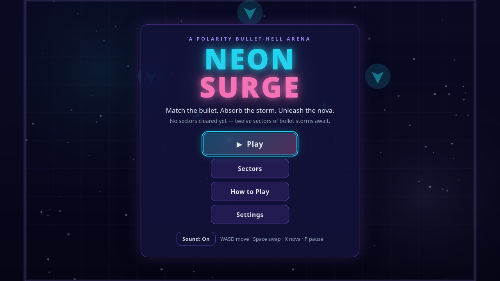

# Neon Surge — Polarity Bullet-Hell Arena



A 2D neon polarity bullet-hell arena. Pilot a wisp through bullet storms:
enemy bullets come in **cyan** and **magenta**. Match your polarity to
**absorb** bullets and build charge — opposite-polarity bullets damage your
hull. Charge powers a **nova** that clears the screen and damages every
enemy. Polarity is the skill: there is no auto-swap, no assist, and no gun.
The nova is your only weapon, and absorbing is the only way to earn one.

**Live:** https://namdev-muse.github.io/neon-surge/ (v1.0.0 — release)

## How to play

- **Move** — WASD / arrow keys. Touch: drag anywhere to steer.
- **Swap polarity** — Space / Shift. Touch: the SWAP button. Instant, but
  every swap is a decision: you can only absorb one colour at a time.
- **Nova** — X or click, once the charge bar is full. Touch: the NOVA
  button. Clears every bullet and damages every enemy.
- **Pause** — P. **Mute** — M. **Restart sector** — R.

Absorbing builds charge (+6 per bullet) and score (+10). A nova costs 65
charge. Clearing a sector scores a time bonus plus a hull bonus. Your best
score per sector is saved; clearing a sector unlocks the next.

## Progression (M4)

- **Clear rank** — finish a sector with 80+ hull for **S**, 50+ for **A**,
  below that **B**. The rank shows on the sector card and on the clear
  screen: the reason to replay a sector for a better result.
- **Endless Drift** — unlocks after clearing Sector 1. Waves of bullet
  patterns keep coming, built from the 12 sectors' patterns and seeded so
  every run deals the same waves: each wave adds enemies and bullet speed
  (capped so the storm stays readable), the polarity mix flips wave to
  wave, and a 3-second breather sits between waves. The run ends at hull
  0; your best wave and best score are saved separately and shown on the
  menu and the end screen. No hull is restored between waves — a good run
  earns its length.

## Sectors (12 hand-crafted)

| # | Sector | Identity |
|---|--------|----------|
| 1 | First Light | Slow cyan bullets first; the first magenta wave is telegraphed so the opening teaches the swap. Drifters, weavers, a sniper, a spinner. |
| 2 | Crossfire | Magenta-heavy mixed fire from both sides; two spinners firing rings at once. Opening softened in M2 by staggered spawns. |
| 3 | Vortex | The densest storm: three spinners, three snipers, crossing weaver spreads. |
| 4 | Twin Currents | Paired weaver streams cross the arena — cyan from the left, magenta from the right. |
| 5 | Sniper's Gallery | Sniper-heavy: six snipers park at the edges and telegraph every shot; drifters fill the gaps. |
| 6 | Ring Road | Spinner-heavy: five spinners, rings everywhere. No single polarity is safe inside a ring. |
| 7 | Crosswind | Weaver-heavy: weavers pour in from every side at once. Keep moving across the wind. |
| 8 | Magenta Tide | Magenta flood with cyan seams — live in magenta, dip into cyan only to feed the nova. |
| 9 | The Spiral | Spinners stack their rings into a spiral; absorb the streams between the rings. |
| 10 | Ambush Alley | Snipers and spinners trade ambushes down the alley; never sit in one lane. |
| 11 | Storm Surge | Everything at once, faster than ever — three-enemy waves, no safe lane. |
| 12 | The Heart | The final gauntlet: every enemy, every pattern, at full speed. |

## Polish & robustness (M5)

- **Wisp readability** — the wisp is now a velocity-pointed dart with a
  white outline and a persistent thin white ring, so it never reads as a
  weaver (a polarity-coloured diamond) in a busy field. The charge arc is
  gold and thicker, at a larger radius, so the two rings never merge.
- **Results persist the moment a run ends** — sector bests and Endless
  bests are recorded when the run phase flips to clear/lost, not 0.9s
  later at the end screen, so a reload during the transition can't lose
  a result.
- **Rank thresholds on the clear screen** — "S at 80 hull · A at 50
  hull", so the player can see what the next rank costs.
- **Real-second timing** — flashes decay in real seconds (a 0.30s flash
  shows for 0.30s) and toasts hide after their real duration, on slow
  devices too. The hit flash is 0.30s.
- **Portrait letterbox** — on tall or very wide screens the bands
  outside the arena are filled with twinkling stars instead of dead
  space.
- **Accessibility** — Settings adds larger text and higher contrast,
  both persisted. Shake (0–100%), flashing and music toggles as before.
- **FPS guard** — if the frame rate stays under 28fps for 2s, the
  canvas DPR cap drops to 1 so the game stops stuttering instead of
  dropping frames.

## Feel (M3)

Every event fires a full tier bundle from the feedback table in
`physics.js` (`FEEDBACK`): trauma shake (shake = trauma²), hit-stop,
flash, slow-mo and shockwaves, layered with particles, number pops and
synth SFX — all inside the frame the event fires. Absorb streaks earn
milestone pops and chimes (×5/10/15/20/30/40/50); reaching a full charge
plays a nova-ready chime; a nova fires slow-mo, a zoom punch and a
shockwave; snipers crack when they shoot. A generative synth loop
(Am–F–C–G bass under an A-minor pentatonic arpeggio) plays under the
game, with a Music toggle in Settings. Screen shake (0–100%) and
flashing can be turned down or off in Settings.

## Enemies

- **Drifter** — drifts in and fires single aimed bullets.
- **Weaver** — sine-wave flight, fires a 5-bullet spread.
- **Sniper** — parks at the edge, glows and draws an aim line, then fires one fast shot.
- **Spinner** — slow rotating star that fires 14-bullet rings with alternating polarity — no single polarity is safe inside one.

## Anti-slop gates

Every sector is verified by bot harness (`node tests/bot.js`):

- A **decision bot** that swaps polarity and novas with real decisions clears all 12 sectors.
- A **no-swap bot** (same movement and nova play, never swaps) loses all 12.
- A **sit-still bot** and a **random masher** lose all 12.
- **Endless Drift:** the decision bot reaches wave 16; no-swap, sit-still
  and random bots all die in wave 1.

If a no-swap bot clears a sector, that sector is not done.

## Run locally

```sh
python3 -m http.server 8932   # then open http://localhost:8932/
```

Playtest path: `?sector=3` jumps straight into sector 3, bypassing the
unlock. `?endless=1` jumps straight into Endless Drift. Both are
deliberately not shown in the UI.

## Tests

```sh
node --check game.js && node --check physics.js
npm run smoke        # 400 assertions: sectors, movement (screen-space),
                     # swap, absorb, damage, nova, enemy fire, saves,
                     # feedback tiers, nova-ready crossing, music setting,
                     # clear ranks, endless wave generation + run flow,
                     # M5 accessibility settings + migration
npm run bot          # anti-slop gates on all 12 sectors + endless drift
npm run render-check # headless Firefox: menu, demo, screen-space movement,
                     # swap, autopilot clear, pause, ?sector=3, ?endless=1,
                     # endless locked/unlocked + wave 1 -> wave 2,
                     # M5 persist-on-flip, rank thresholds, real-second
                     # flash/toast timing, text-size/contrast toggles,
                     # FPS guard DPR drop, zero console errors
npm run screenshots  # size sweep: 1280x720, 2560x1080, 1080x2340 (inspect by eye)
```

## Release notes (v1.0.0)

Built in a 12-hour milestone-driven sprint (2026-11-23 23:30 – 2026-11-24
11:30 Asia/Bangkok), one milestone at a time, each shipped only after a
real-browser playtest judged it fun. M1 core (3 sectors, polarity, nova)
→ M2 twelve hand-crafted sectors → M3 feel & juice → M4 ranks + Endless
Drift → M5 polish & robustness → M6 release. Every sector is gated by
the bot harness above; the live build is the last version that passed
its tests and playtests.

Known issues (honest, none game-breaking):
- Touch buttons (SWAP / NOVA) are verified by code and size sweep, not
  yet on a real touch device — a desktop-browser report of missing
  buttons in Sector 2 / Endless could not be reproduced from the
  shipped code (visibility is gated identically in every mode).
- Portrait HUD verified by 1080x2340 size-sweep screenshots only, not
  on a real phone.
- Music and SFX never got a human-ear check: the synth loop is
  confirmed running by the render check, and a playtester heard
  non-speech audio consistent with it, but nobody has listened
  critically.
- Endless Drift wave 2+, the wave-clear bonus and the 3.0s breather are
  verified by the bot harness and render check only, not by a human
  playthrough.
- Sectors 5 and 9 were never played by a human (they unlock by
  clearing the previous sector); the `?sector=N` path exists for
  testing.
- The CI deploy job fails on every push because Pages is
  branch-sourced; the branch deploy still publishes (verified live
  after every push).

## Tech

Vanilla Canvas 2D, vanilla HTML/CSS/JS, Web Audio API synth SFX, no build
step. Static files on GitHub Pages (main / root). The simulation lives in
`physics.js` (no DOM — fully testable in Node); `game.js` renders it and
owns the menu, HUD, input, particles, trauma shake, hit-stop and nova
slow-mo. Palette: deep-space indigo, cyan + magenta polarities, gold
score/charge/nova, violet arena grid — the same neon family as the series.
